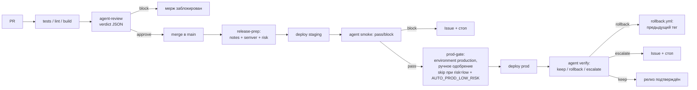

# Агентский CI/CD — «Вариант 2: агент-релиз-менеджер»

Полный скелет релизного поезда с агентскими гейтами и доставкой на прод-клауд через GitHub.

**Принципы**

- Агент готовит, триггерит и проверяет; **прод-креды агенту не выдаются** — фактический деплой делает job с OIDC-кредами (`id-token: write`).
- Прод — через protected GitHub Environments (`production` с required reviewers).
- Все агентские решения — строгий JSON; гейты **fail-closed**: нет валидного JSON → конвейер останавливается, ничего не «проезжает молча».

## Схема



## Структура

```
agentic-cicd/
├── README.md                      ← этот файл
├── .github/workflows/
│   ├── ci-review.yml              # стадия 0: PR → tests + агентский ревью-гейт
│   ├── release.yml                # релизный поезд: prep → staging → smoke → prod → verify
│   └── rollback.yml               # откат на предыдущий тег (dispatch, авто или ручной)
├── prompts/
│   ├── review.md                  # промпт ревьюера PR
│   ├── release-notes.md           # промпт релиз-плана (версия/notes/risk)
│   ├── smoke.md                   # промпт smoke-гейта после staging
│   └── verify.md                  # промпт пост-деплой верификации прода
├── scripts/
│   ├── agent.sh                   # обёртка headless-агента: prompt+context → валидный JSON
│   ├── gate.sh                    # блокирующий гейт по полю verdict
│   ├── deploy.sh                  # плейсхолдер деплоя (fail-closed, под ваш клауд)
│   └── health.sh                  # health-пробы для контекста агента
└── schema/
    └── verdict.schema.json        # контракт агентских ответов
```

📄 Спецификация проекта — аудит инфры/кода, требования, находки и DoD:
[docs/SPEC.md](docs/SPEC.md) (актуальна на 2026-11-03).

## Быстрый старт (чек-лист)

1. **Скопируйте содержимое папки в корень репозитория** (или используйте папку как template).
2. **Job `tests` в `ci-review.yml`** — подставьте команды своего стека (пример дан для npm).
3. **Переменные и секреты** (Settings → Variables and secrets → Actions):

   | Имя | Тип | Назначение | Пример |
   |---|---|---|---|
   | `AGENT_BACKEND` | variable | `heur` (детерминированные эвристики, без секретов) / `cli` (LLM) | `heur` |
   | `AGENT_CMD` | variable | headless-команда агента (для `cli`) | `zcode -p` / `claude -p` |
   | `AGENT_API_KEY` | secret | ключ API агентского CLI | — |
   | `STAGING_HEALTH_URL` | variable | health-endpoint staging | `https://staging.example.com/health` |
   | `PROD_HEALTH_URL` | variable | health-endpoint прод | `https://example.com/health` |
   | `DEPLOY_CMD_STAGING` | variable | команда деплоя (получает `env VERSION`) | `kubectl set image ...` |
   | `DEPLOY_CMD_PRODUCTION` | variable | команда деплоя прод | — |
   | `AUTO_PROD_LOW_RISK` | variable | авто-прод без ручного одобрения для `risk=low` | `true` / `false` |

   ⚠️ Не кладите облачные секреты в `DEPLOY_CMD_*` — используйте OIDC-федерацию или environment secrets.
4. **Environments** (Settings → Environments):
   - `staging` — без защиты (или мягкая);
   - `production` — **required reviewers** (обязательно) + опционально wait timer;
   - `production-auto` — **без required reviewers** (для low-risk авто-деплоя и rollback).

   ⚠️ **Лимит тарифного плана**: branch protection и environment protection rules
   (required reviewers) доступны на приватных репозиториях только с GitHub Pro/Team
   или если репозиторий публичный (API возвращает 403/422 «billing plan» иначе).
   На free+private environment создастся, но гейт `prod-gate` не будет ждать
   ручного одобрения — тогда единственными барьерами остаются fail-closed гейты
   агента и `DEPLOY_CMD` (не задан → деплой не идёт). Аналогично branch protection
   на main: включите после апгрейда/переключения видимости командой из SETUP ниже.
5. **Агентский бэкенд**: по умолчанию `AGENT_BACKEND=heur` — детерминированные эвристики, секреты и CLI не нужны (GitHub Models retired 2026-07-30). Для LLM-агента: `AGENT_BACKEND=cli` + шаг `Install agent CLI` + secret `AGENT_API_KEY`.
6. **Branch protection на `main`**: required status checks — `tests` и `agent-review` из `ci-review.yml`.
7. Merge в `main` → поезд поедет. Нюанс первого релиза: `previous_tag` пуст → авто-rollback недоступен (fail-closed).

## Стадии конвейера

| Стадия | Где | Агент | Блокирует? |
|---|---|---|---|
| tests + agent-review | `ci-review.yml` | вердикт `approve/block` по диффу | да (branch protection) |
| release-prep | `release.yml` | release notes, semver-bump, risk | да |
| deploy-staging | `release.yml` | нет (`scripts/deploy.sh`) | — |
| smoke | `release.yml` | `pass/block` по health-пробам | да (+ Issue) |
| prod-gate | `release.yml` | нет — человек через environment protection | да (skip при low-risk + флаг) |
| deploy prod | `release.yml` (два job'а: reviewed / auto) | нет | — |
| verify | `release.yml` | `keep / rollback / escalate` | rollback → dispatch `rollback.yml`; escalate → Issue |

## Rollback

- **Авто**: вердикт `verify = rollback` → dispatch `rollback.yml` на предыдущий тег (`previous_tag` из release-prep).
- **Ручной**: `gh workflow run rollback.yml -f tag=v1.2.2 -f reason="инцидент"`.

## Аудит

Каждая агентская стадия публикует артефакт с сырым вердиктом: `agent-verdict`, `release-plan`, `smoke-verdict`, `verify-verdict`. Храните их для разбора инцидентов.

## Кастомизация

- `scripts/deploy.sh` — обёртка деплоя: без `DEPLOY_CMD_*` падает с подсказкой (ничего не деплоим «вслепую»). Впишите реальный деплой через переменные или прямо в deploy-job'ы.
- `scripts/demo-deploy.sh` — текущий таргет (`DEPLOY_CMD_*` указывают на него): поднимает артефакт на раннере и проверяет /health. Это demo-заглушка; для прода замените `DEPLOY_CMD_*` на команду реального клауда. Аналогично smoke/verify: без health-URL работают в DEMO-режиме против локально поднятого артефакта.
- `scripts/metrics.sh` (опционально) — ваш read-only хук метрик (Prometheus/CloudWatch API); его вывод попадает агенту в контекст verify.
- Пороги решений агента — в `prompts/verify.md`; можете вынести в variable и подставлять.

## Безопасность

- OIDC вместо статических ключей; облачные креды живут только в deploy-job'ах.
- Права токенов минимальны и разложены по job'ам: `contents: write` только у release-prep (тег/release), `actions: write` только у verify (dispatch rollback), `pull-requests: write` только у ревью.
- `workflow_dispatch`, вызванный через GITHUB_TOKEN, триггерит workflow (официальное исключение из правила «token-events не создают runs») — цепочка авто-rollback работает.
- Секреты агента (`AGENT_API_KEY`) отделены от облачных; раннеры эфемерные; вердикты — в артефактах.

## Включение branch protection (после апгрейда или переключения в public)

```bash
gh api -X PUT repos/<owner>/<repo>/branches/main/protection --input - <<'EOF'
{
  "required_status_checks": { "strict": true, "contexts": ["tests", "agent-review"] },
  "enforce_admins": false,
  "required_pull_request_reviews": { "required_approving_review_count": 1 },
  "restrictions": null,
  "required_linear_history": true,
  "allow_force_pushes": false,
  "allow_deletions": false
}
EOF
```

Для required reviewers на environment `production`:

```bash
USER_ID="$(gh api user --jq .id)"
printf '{"wait_timer":0,"reviewers":[{"type":"User","id":%s}],"prevent_self_review":false}' "$USER_ID" \
  | gh api -X PUT repos/<owner>/<repo>/environments/production --input -
```

## Ограничения

- Вердикт агента — вероятностный: блокирующие решения всегда дублируются скриптовыми гейтами (`gate.sh`, exit codes). Промпты можно ужесточать, но не полагаться на модель как на единственный барьер.
- Деплой — плейсхолдер: пока не заданы `DEPLOY_CMD_*`, конвейер честно падает до staging.
- Один релизный поезд за раз: job-уровневые concurrency-группы (`release-prep`, `staging-deploy`, `production-deploy`) сериализуют конкурирующие прогоны.
